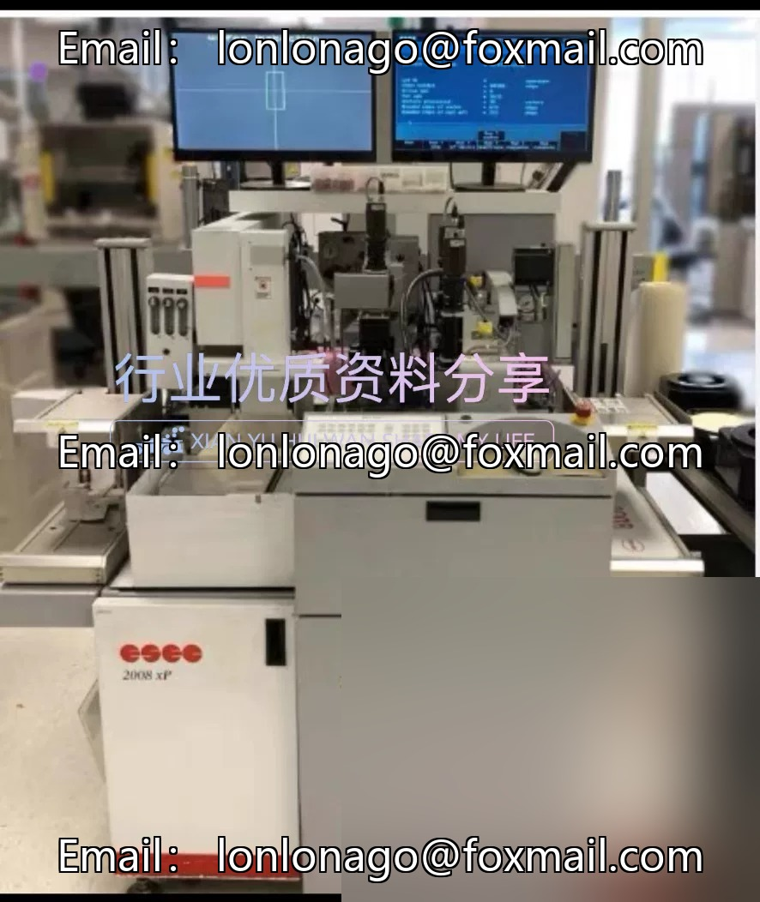
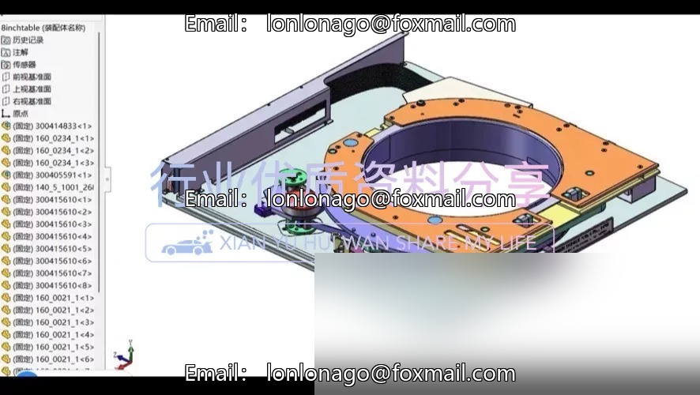
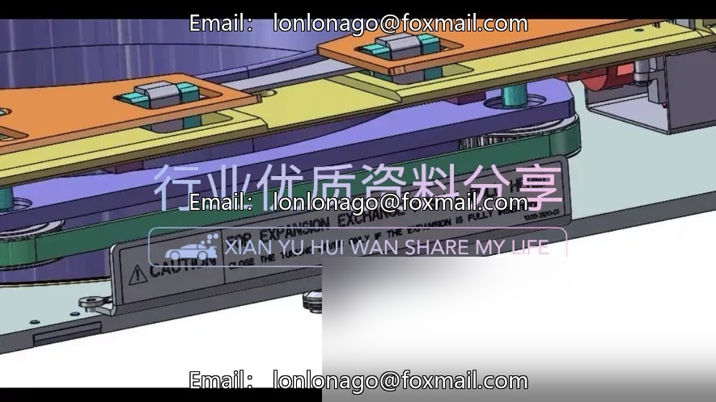

# ESEC2008 Semiconductor Crystal Machine wafer platform 3D drawing: German original drawing, European design concept

## Body

ESEC2008 Solid Crystal Machine Wafer Platform 3D Drawing: German original drawing, very special European design thinking! Standardized design approach! Worth in-depth study! The design is perfect, with no details that can be criticized! Stp!

Take a photo and send the electronic original directly! The following images contain file screenshots. Please confirm before placing the order! Due to the copyability of electronic data documents, So after purchase, are allowed! Thank you for understanding!

For personal learning and reference use only.

The document is the ESEC2008 solid crystal machine wafer platform 3D drawing, featuring German original graphics, European design thinking, a standardized design approach, and meticulous details.

<!-- AI_ENRICHED -->

## Images

## Payment

Here is a pay link on Stripe ( https://buy.stripe.com/3cs8yP7sY87d0vu9AB ). Please contact me lonlonago@foxmail.com after funding $89, and I will send you a complete data files , thank you!

